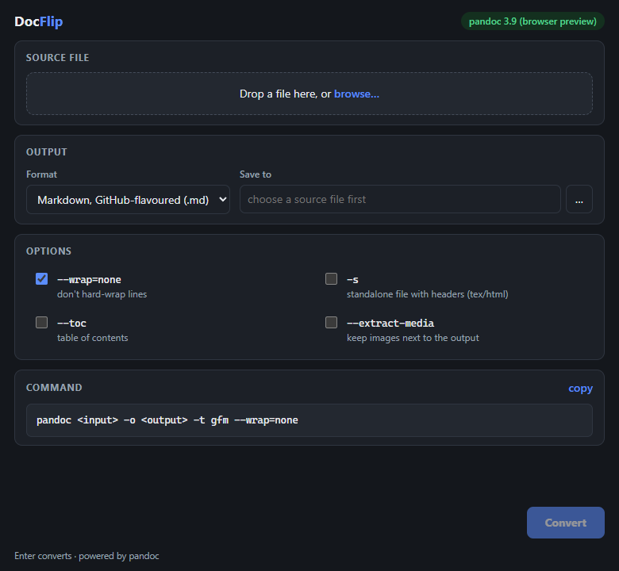

# DocFlip

**A small, fast desktop GUI for [pandoc](https://pandoc.org/).** Drop a file on the window, pick
an output format, click Convert — no more remembering flags. The exact pandoc command is shown
live as you change options, so you learn it while you use it.

Windows and Linux, one codebase, ~2 MB installer, starts instantly.

[](https://github.com/SarmaSaurav/docflip/actions/workflows/ci.yml)



## Install

### Windows

1. Download `DocFlip_*_x64-setup.exe` (or the `.msi`) from [Releases](../../releases) and run it.
   - The installer isn't code-signed, so SmartScreen may show *"Windows protected your PC"* —
     click **More info → Run anyway**.
2. Install pandoc (DocFlip drives pandoc instead of bundling it):

   ```sh
   winget install JohnMacFarlane.Pandoc
   ```

3. Start DocFlip. A green **pandoc x.y.z** pill in the header means you're ready.

### Linux

- **Debian / Ubuntu** — `sudo apt install ./DocFlip_*_amd64.deb`
- **Any distro (AppImage)** — `chmod +x DocFlip_*_amd64.AppImage`, then run it. If it won't
  start, install FUSE first: `sudo apt install libfuse2`.
- Pandoc: `sudo apt install pandoc` (or from [pandoc.org](https://pandoc.org/download.html)).

Nothing else is needed at runtime: no Node, no Python, no browser install (WebView2 ships with
Windows 10/11; on Linux DocFlip uses the WebKitGTK that desktops already have).

## Use

1. Drop a file onto the window (or click the drop zone to browse)
2. Pick the output format — the output path defaults to the same folder with the new extension
3. Toggle options; the command line below updates as you go
4. Press **Enter** or click **Convert**

### Options

| Option | Flag | When it matters |
|---|---|---|
| Wrap | `--wrap=none` | Clean Markdown — no hard-wrapped lines |
| Standalone | `-s` | Self-contained `.tex`/`.html` with headers instead of a fragment |
| Table of contents | `--toc` | Long documents in HTML, LaTeX, EPUB |
| Extract media | `--extract-media=…` | Pulling images out of docx/odt/epub into a folder next to the output |
| Reference doc | `--reference-doc=…` | Styling the output from your own Word/OpenDocument template |

Sensible defaults are applied per format: `--extract-media` is pre-checked for docx/odt/epub
sources, `-s` for tex/html, and `--reference-doc` is only offered where it exists.

Converting `report.docx` to docx writes `report-converted.docx` — DocFlip never points the
output at your source file, and it asks before overwriting anything else.

## Supported conversions

- **From** (auto-detected by extension): `.docx` `.md` `.tex` `.html` `.epub` `.odt` `.rst`
- **To**: Word, Markdown (GitHub-flavoured), HTML, LaTeX, EPUB, OpenDocument, reStructuredText

Anything else pandoc can do is still one click away: the **copy** button hands you the full
command to paste into a terminal.

## When something goes wrong

- **"Pandoc was not found on PATH"** — run the install command shown in the message
  (`winget` on Windows, `sudo apt install pandoc` on Debian/Ubuntu), then restart DocFlip.
- **The conversion fails** — the red box shows pandoc's own error message verbatim (for example
  an unsupported source→target pair). The command preview shows exactly what was run.
- **Warnings after a green conversion** — pandoc succeeded but had notes (e.g. a missing title
  when writing standalone HTML). The file was still written.
- **macOS** is not packaged yet (see the roadmap in [PLAN.md](PLAN.md)); building from source
  works — see [DEVELOPMENT.md](DEVELOPMENT.md).

## More

Building from source, running the tests, how the app is put together, and the release process:
[DEVELOPMENT.md](DEVELOPMENT.md). Design notes, scope and roadmap: [PLAN.md](PLAN.md).
